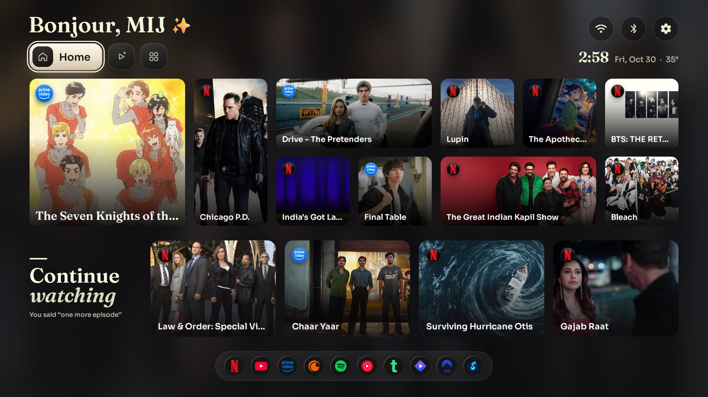
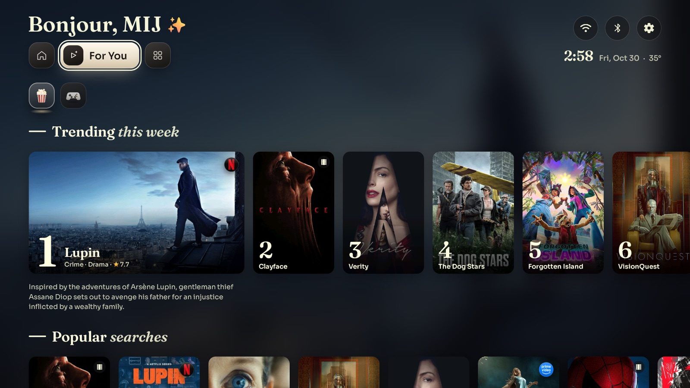
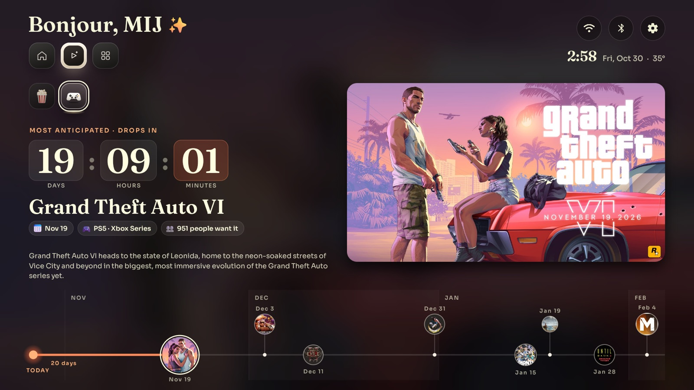
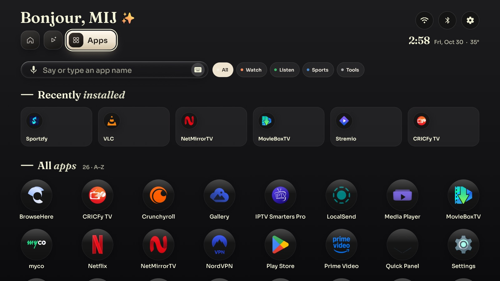
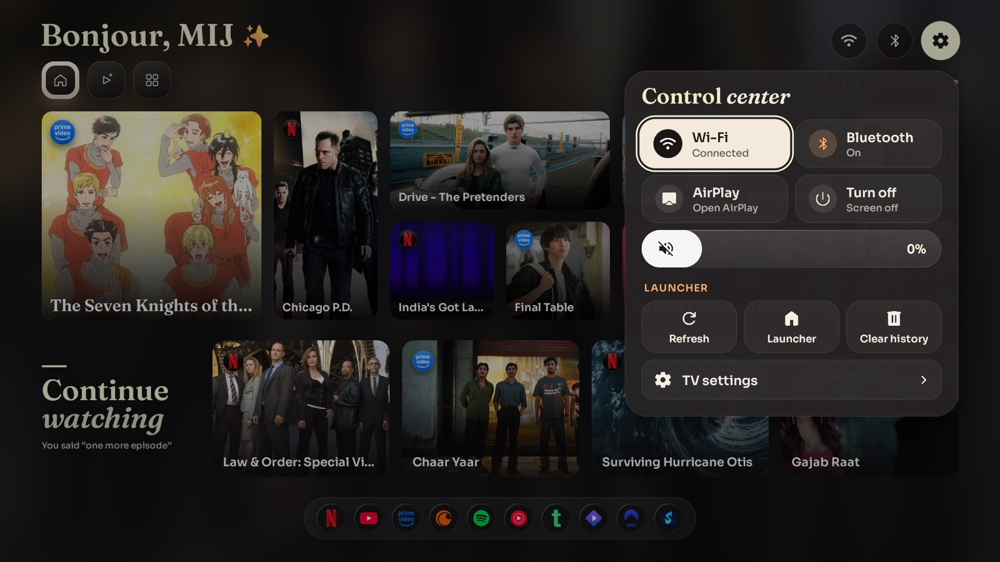
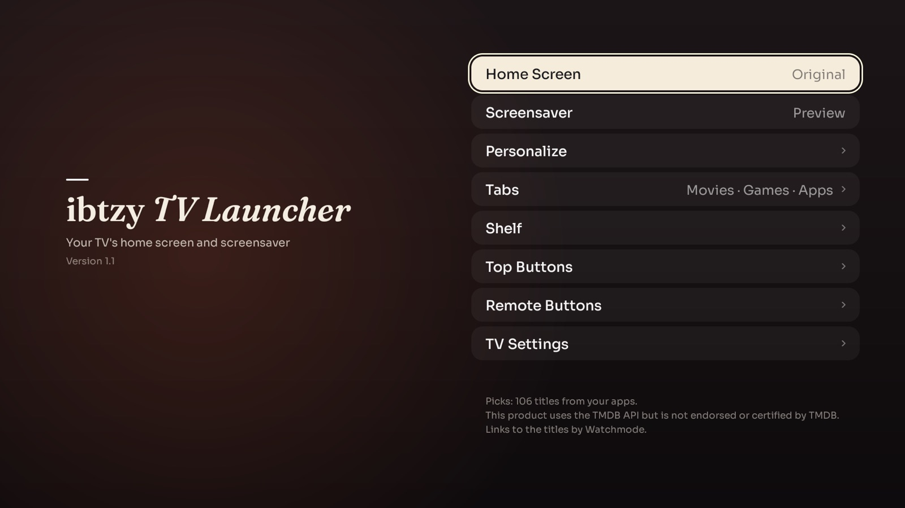
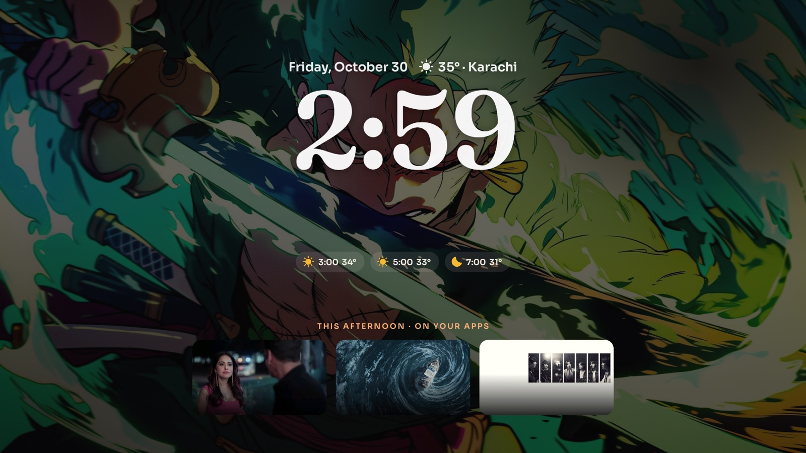

# ibtzy TV Launcher

A fast, ad-free home screen for Google TV and Android TV, tuned on a TCL TV.

- **Home**: your apps, continue watching and today's picks.
- **For You**: Movies & Shows and Games (release countdown, Hype Track, trending).
- **Apps**: search or say an app, categories (Watch, Listen, Sports, Tools), most used.
- One switch back to the TV's original home screen.

| Home | For You: Movies & Shows |
|---|---|
|  |  |
| **For You: Games** | **Apps** |
|  |  |
| **Control center** | **Settings** |
|  |  |
| **Screensaver** (your photos, `screensaver/`) | |
|  | |

## Build

No Gradle: `build.sh` runs aapt2, javac, d8 and apksigner from the Android SDK.

```sh
cp config.example.properties config.properties   # then add your own keys
./build.sh                                        # makes ibtzyTVLauncher.apk
adb connect <TV IP>:5555
adb install -r ibtzyTVLauncher.apk
adb shell cmd package compile -m speed -f io.ibtzy.tvlauncher
```

`config.properties` (API keys, city) and the signing keystore stay on your computer: both are in `.gitignore`.
Keep the keystore: updates must be signed with the same one.

## Tests

```sh
bash tools/tests/run.sh
```

## Credits

Based on [Free My TV](https://github.com/simbasjungles/free-my-tv) (MIT License, see `LICENSE`).
Game data: IGDB, RAWG, SteamGridDB, Wikipedia. Movie data: TMDB.
